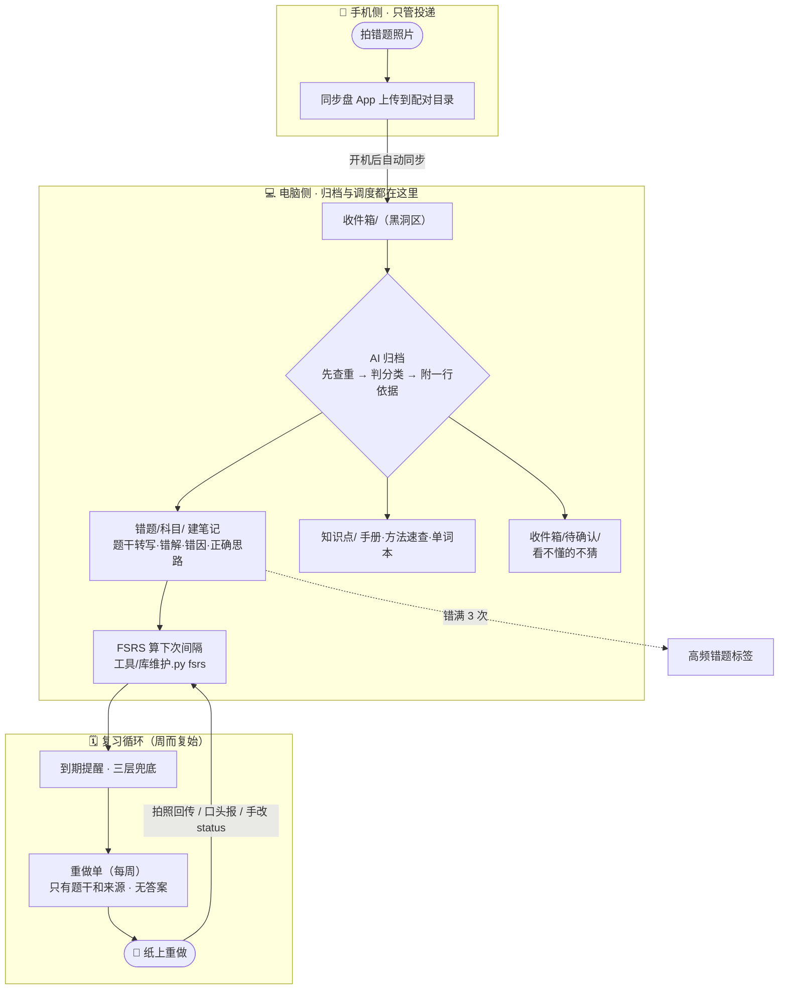
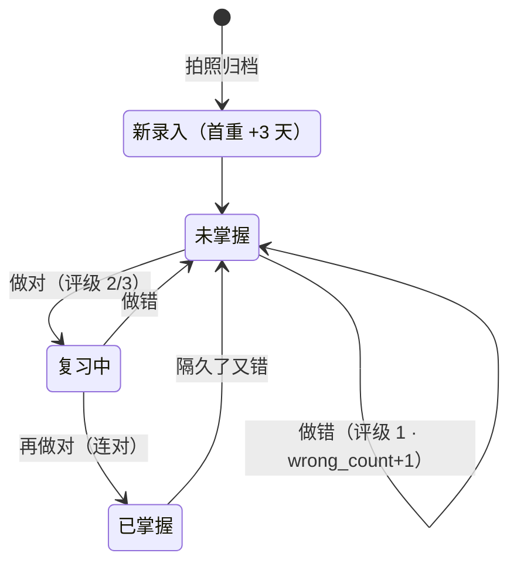
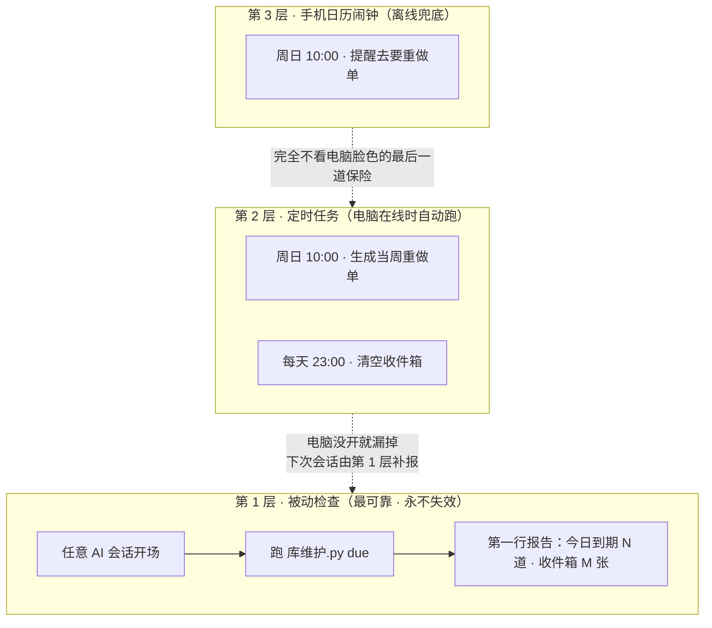
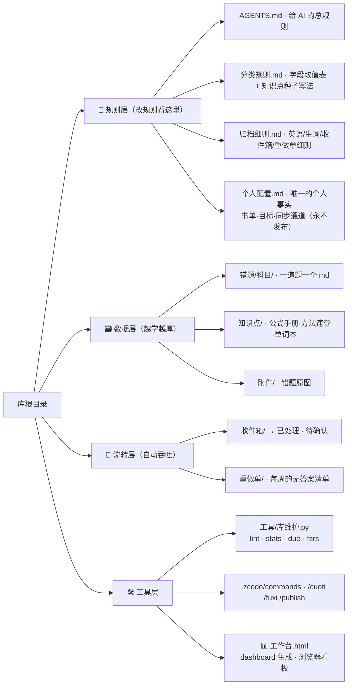
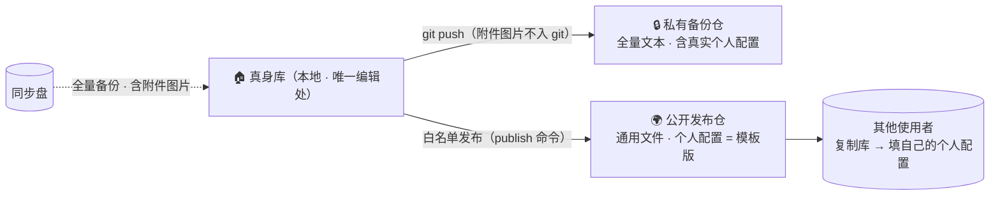

# 架构图（整套系统怎么运转）

> 用 Obsidian 打开本文件即可看图（Mermaid 原生渲染，无需插件）。共 5 张：全景链路 → 错题生命周期 → 三层提醒 → 目录地图 → 双仓备份与发布。

## 一、全景：一张错题照片的旅程

要点：手机永远只负责"投递"，电脑不在线也不丢图；答案只存在笔记里，重做单上永远看不到。

## 二、一道错题的生命周期（FSRS 调度）

| 你反馈的 | 评级 | FSRS 做什么 |
|---|---|---|
| 又做错了 | 1 重忘 | 间隔重算，很快回来 |
| 做对了但很吃力 | 2 困难 | 间隔小幅拉长 |
| 做对了（默认） | 3 正常 | 间隔按全部历史拉长 |
| 秒杀 / 很轻松 | 4 简单 | 间隔大幅拉长 |

要点：不再固定 +3/+7/+30——间隔由算法按这道题**全部**复习历史算出，做得越久对你忘性的估计越准。

## 三、三层提醒（谁都不会静默失效）

要点：第 1 层写死在 AGENTS.md 里，不依赖任何定时任务存活——只要你还跟 AI 说话，就不会错过积压。

## 四、目录地图（每个文件夹是干嘛的）

## 五、双仓备份与发布（隐私怎么隔开）

要点：改任何规则只改真身库一处；发布只走白名单，真实版 `个人配置.md` 永不在名单里——隐私靠机制而非靠小心。
